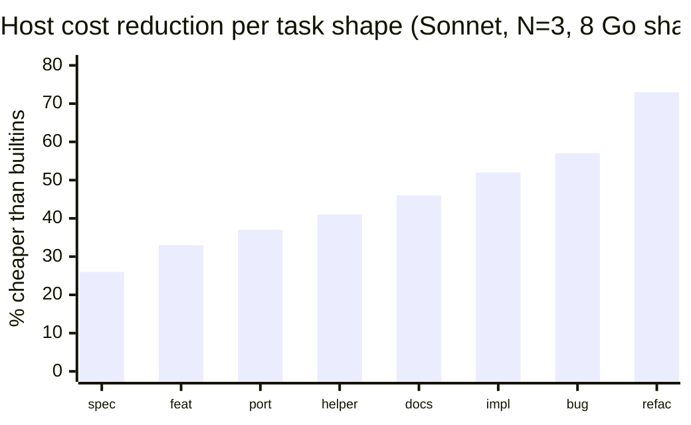
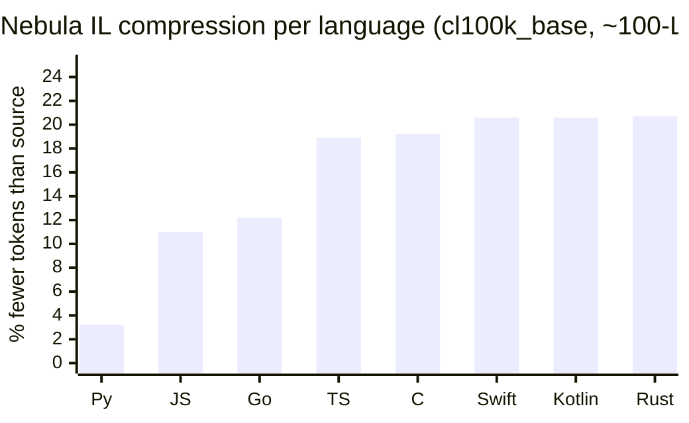
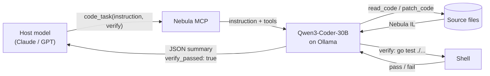

# Nebula

**An MCP server that cuts host-model code-editing cost by ~50% on Claude Sonnet — without fine-tuning, without changing your workflow, without losing correctness.**

Drop one tool (`code_task`) into your Claude Code config. The host stops making twenty Read/Edit/Bash calls per task and starts making one. A local Qwen3-Coder-30B on Ollama does the actual work. You keep the smart host. You just stop paying it to shuffle bytes.





Two mechanisms, additive. The **delegate** hides the tool surface from the host (−51% weighted mean, 8 code-editing shapes, Sonnet, 24/24 correct). The **IL** compresses source across every language Nebula ingests (16.2% mean). On large files both stack: −44% combined vs. −23% from delegation alone. See [Research](#research) for the full breakdown.

---

**[▸ MCP Quick Start](#mcp)** · **[▸ Language](#language)** · **[▸ Research](#research)** · **[▸ Paper](bench/paper.md)** · **[▸ Spec](spec/LANGUAGE.md)**

---

## MCP

One binary, six tools, two modes that compose freely in one session.

### Quick start

1. **Build the MCP server.**
   ```sh
   git clone https://github.com/colinc86/nebula.git && cd nebula
   cargo build --release --manifest-path compiler/Cargo.toml
   ```
   The binary lands at `compiler/target/release/nebula`.

2. **Install Ollama and pull the delegate worker** (only needed for `code_task`; the compression tools work without Ollama).
   ```sh
   ollama pull qwen3-coder:30b
   ```

3. **Wire it into Claude Code.** Add to `~/.claude/mcp.json` (or pass via `--mcp-config`):
   ```json
   {
     "mcpServers": {
       "nebula": {
         "command": "/absolute/path/to/nebula/compiler/target/release/nebula",
         "args": ["mcp"],
         "env": {
           "NEBULA_DELEGATE_OLLAMA_URL": "http://localhost:11434",
           "NEBULA_DELEGATE_MODEL": "qwen3-coder:30b"
         }
       }
     }
   }
   ```

4. **Restart Claude Code.** All six tools are now available. That's it.

> **Note.** Works with any MCP-capable host (Claude Code, Cursor, Zed, custom clients). Savings depend on whether the host *chooses* to delegate: Sonnet-class models route to `code_task` reliably; Opus under-delegates on small tasks and forfeits most of the savings — see [Research §Host routing propensity](#research).

### The tools

| Tool | Mode | What it does |
|---|---|---|
| **`code_task`** | Delegate | Hand off a natural-language task + a `verify` command. Inner agent reads/edits files, runs verify, auto-retries up to 3 times on failure, returns one JSON summary with `verify_passed`. One host turn, one host billing event. |
| `read_code` | Compression | Read any source file. Returns it in Nebula IL (≤40-line files pass through as-is). Works on 8 languages. |
| `write_code` | Compression | Write Nebula code. Auto-translates to the file's native language by extension. |
| `patch_code` | Compression | Byte-level `old_str → new_str` edit on native source. Single-file or bulk glob (one call replaces across a whole package). |
| `search_code` | Compression | Substring + IL-canonical search; results returned as Nebula snippets. |
| `translate_code` | Compression | Any-to-any translation across 8 languages via Nebula IL. Neural (Ollama) if available, rule-based otherwise. |

### When to use which

- **`code_task`** — multi-turn work: refactors, bug fixes, feature additions, anything the host would otherwise drive for more than ~3–4 tool calls. The break-even is ≈3.4 host turns ([cost model §3](bench/cost_model.md#3-break-even-point)).
- **Compression tools** — read-heavy exploration, single-shot edits, or sessions where you want to stay in direct control of the outer agent. No Ollama needed.
- **Both at once** (default). They are orthogonal; the host picks per call. Hide the tool surface on the hard stuff, stay direct on the easy stuff.

### How `code_task` works



The host sees one tool call and one JSON response. Everything inside the dashed region — reads, patches, verify loop, retries — is invisible and uncharged. If `verify_passed: true`, the work is done and tested; you do not need to re-verify.

### Configuration

Environment variables (all optional):

| Variable | Default | Effect |
|---|---|---|
| `NEBULA_MCP_TOOLS` | unset = all six | Comma allow-list. Set to `code_task` for delegate-only, or `read_code,patch_code,search_code` for compression-only. |
| `NEBULA_DISABLE_IL` | unset | `1` forces `read_code` to return raw source (bypasses IL compression). |
| `NEBULA_DELEGATE_MODEL` | `qwen3-coder:30b` | Inner-agent Ollama model. |
| `NEBULA_DELEGATE_OLLAMA_URL` | `http://localhost:11434` | Inner-agent endpoint. |
| `NEBULA_OLLAMA_MODEL` | `nebula-8lang-14b-q4` | Neural translation backend for `translate_code`. |
| `NEBULA_OLLAMA_URL` | `http://localhost:11434` | Neural translation endpoint. |

If Ollama is unreachable, `code_task` returns a structured error. The compression tools keep working — they have no Ollama dependency.

---

## Language

Nebula is a universal code intermediate language. Eight ingesters normalize source into one canonical form; eight codegens emit idiomatic output. That same IL is what `read_code` returns and what the delegate agent thinks in.

```nebula
def fibonacci(n):
    if n <= 1:
        return n
    a, b = 0, 1
    for i in 2..=n:
        a, b = b, a + b
    return b
```

| Direction | Languages |
|---|---|
| **Ingest** (source → Nebula) | Python, JavaScript, TypeScript, Go, Swift, Kotlin, Rust, C |
| **Codegen** (Nebula → target) | Python, JavaScript, TypeScript, Go, Swift, Kotlin, Rust, C |
| **Neural translator** (fine-tuned Qwen) | Python, JavaScript, TypeScript, Go, Rust, C |

Design principles: every syntax choice validated by a cl100k_base tokenizer audit; no special cases; any language maps cleanly in and out; strip ceremony the target doesn't need (Go pointers, Rust lifetimes, C includes).

**Deeper reading:**
- [Full language specification →](spec/LANGUAGE.md)
- [Syntax cheatsheet →](spec/CHEATSHEET.md)
- [Compression methodology & per-language results →](bench/results.md)
- [Neural translator training guide →](TRAINING.md)

---

## Research

We collapse the code-editing tool surface to a single natural-language MCP tool backed by a stock local worker (Qwen3-Coder-30B on one RTX 3090). On 8 matched-pair Go shapes with Claude Sonnet as host, this reduces billable host cost by a weighted **−51.2%** without loss of correctness (24/24 tasks pass). A fitted linear cost model predicts the break-even at **≈3.4 host turns**; every shape in the benchmark clears it.

### Headline numbers

| Axis | Experiment | Result | Source |
|---|---|---|---|
| Host token cost | 8-shape matched pair, Sonnet, N=3 | **−51.2%** weighted mean host cost, 24/24 correct | [`bench/cost_model.md §2`](bench/cost_model.md#2-fitting-to-the-full-8-shape-sonnet-data-iterations-17--18) |
| Host token cost | Large-file ablation (425-LoC Go, N=3) | tool-hiding −23.1% + IL compression −21.2pp = combined **−44.3%** | [`bench/cost_model.md §4.6`](bench/cost_model.md#46-the-nebula-il-contribution-iter-19-large-file-shape) |
| Inner-loop wall-clock | 7-shape, multi-task fine-tuned 30B-Coder, N=3 | **−54.8%** mean wall-clock vs stock inner agent, 21/21 trials correct (8th shape `large_file`: 1/3 pass, capability gap from no-large-file training data) | [`bench/paper.md §5.6`](bench/paper.md#56-phase-20-multi-task-fine-tune-as-a-wall-clock-lever) |
| End-to-end correctness | GAIA subset (13 code-editing tasks, N=1) | accuracy-invariant: 10/13 correct under both configs, identical failures | [`bench/gaia/`](bench/gaia/) |
| Host routing | Opus 4.6 on 15 small-shape trials | Opus delegated 1/15 → savings collapse to noise on small tasks | [`bench/cost_model.md §4.5`](bench/cost_model.md#45-host-model-behavior-opus-check) |

### What we claim (and what we don't)

The novel contribution is the framing and the measurement: **collapse the tool surface to one natural-language MCP tool, measure host billable cost on matched pairs, and report routing propensity as a first-class limiting variable.** The core insight (hide expensive tool calls from the expensive model) is shared with CodeAgents and AWO; our value-add is a clean code-editing benchmark with a fitted cost model and the separation of tool-hiding from IL compression as two independent, additive mechanisms.

> **Cross-language validation (iter 21).** The delegate benchmark is now validated across all 8 Nebula languages — Python, JavaScript, TypeScript, Go, Swift, Kotlin, Rust, and C — on **two shapes** (add_feature and bugfix). **96/96 trials verify_passed**, confirming the delegate mechanism is architecturally portable. The per-language cost picture depends on host routing propensity:
>
> | Shape | Routing | Mean Δ | Median Δ |
> |---|---|---:|---:|
> | **add_feature** (4-turn shape) | **8/8 langs route** | −7.1% | **−12.2%** |
> | **bugfix** (12-turn shape) | 6/8 langs route (Swift, Kotlin refuse; Python has verbose replies) | −7.5% | +1.4% |
>
> On shapes/languages where Sonnet actually delegates, savings match the cost model cleanly: Go −35.9%, TypeScript −25.2%, JavaScript −21.4%, C −17.6%, Rust −9.4% on bugfix. Swift and Kotlin route fine on add_feature (−13% each) but refuse to delegate bugfix, so their aggregate sits flat. Routing propensity is (language × shape × host)-dependent and mirrors the Opus small-shape routing caveat from §5.2–5.4. Full data + regime analysis: [`bench/paper.md §5.7`](bench/paper.md#57-cross-language-portability-iter-21).

**Full writeups:**
- [Paper draft →](bench/paper.md) — abstract, methodology, all tables, related work
- [Cost model →](bench/cost_model.md) — notation, fit, break-even, held-out MAPE, host-routing analysis
- [Iteration log →](bench/loop_notes.md) — every decision and dead-end from iterations 1–18
- [Raw benchmark runs →](bench/mcp_manual_test/RESULTS.md) — per-shape numbers and variance
- [GAIA comparison →](bench/gaia/) — head-to-head vs. CodeAgents on code-editing-shaped level-1 tasks

---

## Project structure

```
compiler/       Rust compiler, interpreter, MCP server, 8 ingesters, 8 codegens
  src/mcp.rs             MCP JSON-RPC server (6 tools)
  src/mcp_delegate.rs    code_task inner-agent loop
  src/ingest.rs          Tree-sitter → Nebula canonicalization
  src/codegen.rs         Nebula → target language
spec/           Language specification and cheatsheet
bench/          Benchmark suite, paper, cost model, iteration log
  mcp_manual_test/       Matched-pair delegate benchmark templates + runners
  gaia/                  GAIA / CodeAgents comparison
  finetune/              Neural refinement pipeline (training, eval)
examples/       Working .neb programs
```

## References

1. Sun et al. *SimPy: Revealing the Hidden Simplicity in Python Programs for Token Efficiency.* ISSTA 2024. [arXiv:2404.16333](https://arxiv.org/abs/2404.16333)
2. Sun et al. *Token Sugar: Making Source Code Sweeter for LLMs through Token-Efficient Shorthand.* ASE 2025. [arXiv:2512.08266](https://arxiv.org/abs/2512.08266)
3. Li et al. *CodeAgents: Efficient Multi-Agent Code Generation via Structured Planning.* arXiv 2025. [arXiv:2507.03254](https://arxiv.org/abs/2507.03254)
4. Yan et al. *InterTrans: Leveraging Transitive Intermediate Translations to Enhance LLM-based Code Translation.* ICSE 2025. [arXiv:2411.01063](https://arxiv.org/abs/2411.01063)
5. Zheng et al. *UniCoder: Scaling Code Large Language Model via Universal Code.* ACL 2024. [arXiv:2406.16441](https://arxiv.org/abs/2406.16441)
6. Szafraniec et al. *Code Translation with Compiler Representations.* ICLR 2023. [arXiv:2207.03578](https://arxiv.org/abs/2207.03578)

[Third-party licenses](THIRD_PARTY_NOTICES.md) · Nebula language spec at [`spec/LANGUAGE.md`](spec/LANGUAGE.md)
